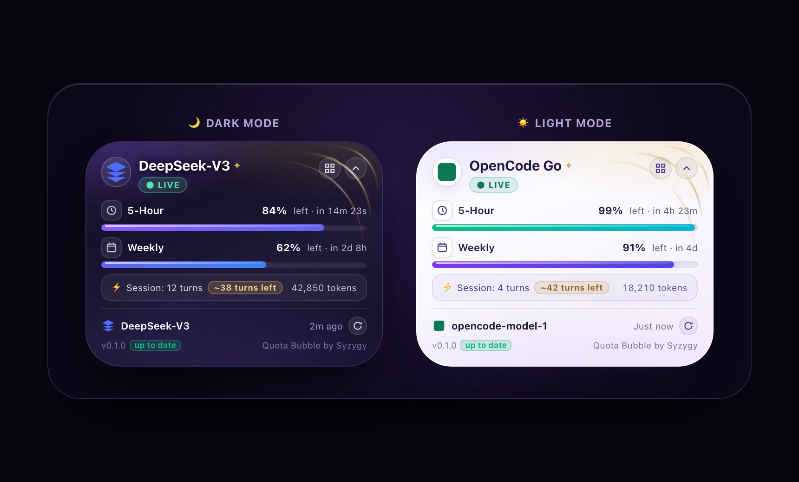
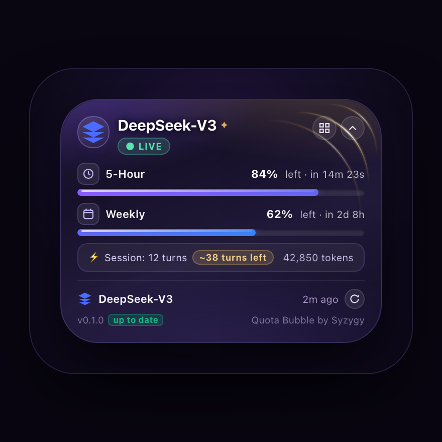
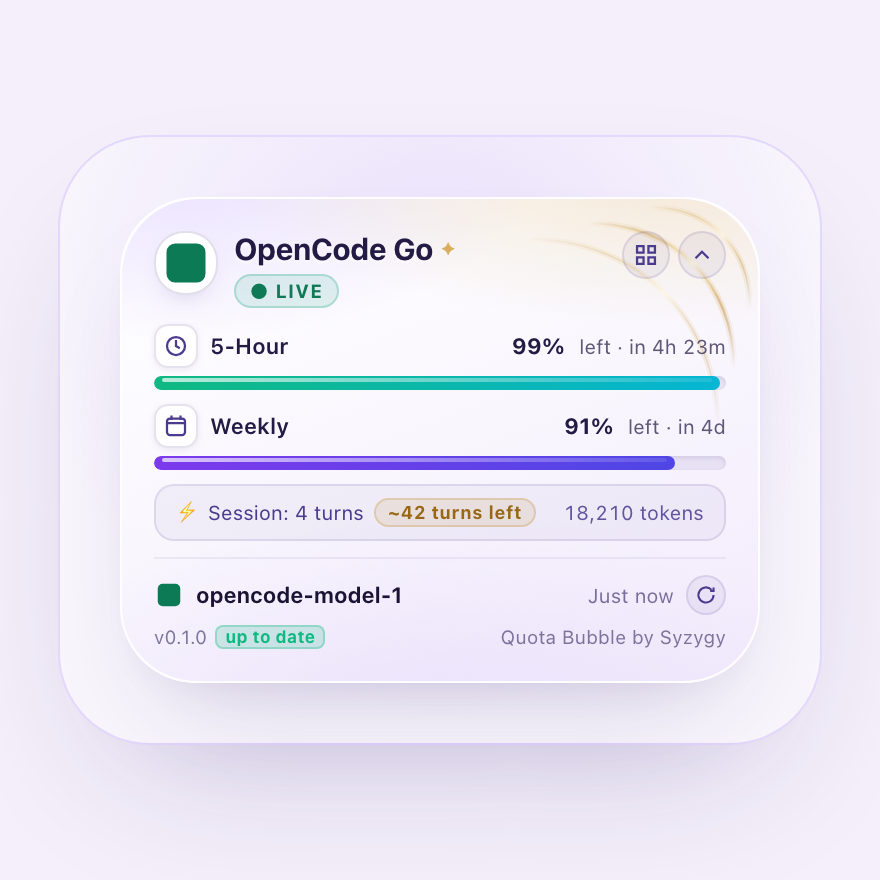

# Quota Bubble (`dsh-quota-bubble`)

> **Real-time provider-verifiable telemetry, predictive runway estimation, and multi-quadrant glass overlay engineered for the DeepSeek Harness ecosystem.**

<p align="center">
  
</p>

<p align="center">
  <a href="https://www.npmjs.com/package/dsh-quota-bubble"></a>
  
  
  
  
  <a href="./LICENSE"></a>
</p>

---

## Table of Contents

- [Architectural Philosophy](#architectural-philosophy)
- [Visual Interface Showcase](#visual-interface-showcase)
- [Key Engineering Highlights](#key-engineering-highlights)
  - [Concentric Caustic Arcs (Option A)](#1-concentric-caustic-arcs-option-a)
  - [Burn Rate & Predictive Runway Estimation](#2-burn-rate--predictive-runway-estimation)
  - [Live Second-Accurate Countdown Tickers](#3-live-second-accurate-countdown-tickers)
  - [Quad-Quadrant Draggable Docking](#4-quad-quadrant-draggable-docking)
  - [Antigravity Multi-Account Synchronizer](#5-antigravity-multi-account-synchronizer)
  - [Adaptive Version Intelligence](#6-adaptive-version-intelligence)
- [Performance & Resource Hardening](#performance--resource-hardening)
- [Provider Telemetry Matrix](#provider-telemetry-matrix)
- [Controls & Shortcuts](#controls--shortcuts)
- [Installation & Integration](#installation--integration)
- [Design Token Governance (DTCG)](#design-token-governance-dtcg)
- [Privacy, Sandboxing & Security Seams](#privacy-sandboxing--security-seams)
- [Verification & Automated Test Suite](#verification--automated-test-suite)
- [License & Authors](#license--authors)

---

## Architectural Philosophy

Cloud LLM token consumption is traditionally fragmented across disconnected billing consoles, opaque rate-limit headers, and scattered environment variables. Developers interacting with conversational AI in high-velocity loops are frequently disrupted by sudden quota exhaustion.

**Quota Bubble** remedies this friction by embedding an ambient, unobtrusive, and mathematically rigorous telemetry HUD directly into the DeepSeek Harness interface. 

### Core Tenets

1. **Provider Truth Over Synthetic Emulation:** The plugin probes authoritative provider endpoints directly. If a provider API does not publish a telemetry endpoint, the bubble exhibits intellectual honesty—declaring `NO API` rather than conjecturing synthetic token counts.
2. **Deterministic Cordis Reactivity:** Built specifically for the DeepSeek Harness Cordis kernel, the bubble dynamically synchronizes with active session projections (`@deepseek-ai/dsh-client-ui-session`), immediately tracking model migrations and chat switches with sub-millisecond dispatch.
3. **Restraint in Motion & Spatial Elegance:** Visual assets are calibrated to stay subordinate to primary cognitive workflows. Ambient caustics and status indicators are rendered with champagne gold hairlines and delicate opacity gradients designed never to distract the developer's peripheral vision.

---

## Visual Interface Showcase

<table align="center" width="100%">
  <tr>
    <td align="center" width="50%">
      <b>Dark Mode Studio Canvas</b><br/><br/>
      
    </td>
    <td align="center" width="50%">
      <b>Light Mode Studio Canvas</b><br/><br/>
      
    </td>
  </tr>
</table>

---

## Key Engineering Highlights

### 1. Concentric Caustic Arcs (Option A)
Anchored in the upper-right corner of the bubble, the **Option A Caustic Arcs** create a refined luxury watchmaker aesthetic:
- **Geometry:** Three concentric hairlines (`0.75px`, `1.20px`, and `0.85px`) mathematically echo the squircle container's `38px` corner curvature.
- **Champagne Radiance:** Utilizes a custom 5-stop linear gradient (`#c8973f` to `#fff6dd` to `#a97b2a`) with asymmetric stroke caps.
- **Ambient Caustic Layer:** An underlying soft Gaussian-glow refraction layer (`stroke-width: 3.5px`, alpha `0.22`–`0.35`) delivers depth without bleeding into text contrast.

### 2. Burn Rate & Predictive Runway Estimation
The integrated `computeSessionRunway()` analytics engine inspects quota deltas across turns within the active session:
- **Telemetry Metric:** Correlates cumulative quota percentage consumed against the session turn counter.
- **Runway Forecast:** Renders an inline pill indicator `⚡ Session: N turns [ ~X turns left ]`, giving developers advance warning before quota depletion occurs.
- **Context-Aware Safety:** Automatically flags depletion thresholds (`isLow: true`) when estimated runway falls below 5 conversation turns.

### 3. Live Second-Accurate Countdown Tickers
Rate-limiting windows (e.g., 5-hour rolling quotas or weekly quotas) feature independent, sub-second countdown timers:
- **Local Reactive Engine:** Ticks down every 1,000ms using local client timestamps without generating repetitive network roundtrips.
- **Humanized Formatting:** Intelligently transitions between days (`2d 8h`), hours and minutes (`4h 23m`), and seconds (`14m 23s`).
- **Automatic Drift Re-sync:** Re-anchors itself against authoritative server timestamps whenever fresh quota payloads arrive.

### 4. Quad-Quadrant Draggable Docking
The bubble adapts gracefully to any desktop workspace configuration:
- **One-Click Quadrant Cycling:** An integrated dock quadrant button seamlessly cycles the bubble between `bottom-right`, `bottom-left`, `top-left`, and `top-right`.
- **Drag & Snap Kinematics:** Drag the card header or collapsed pill to reposition anywhere on screen with automatic magnetic corner snapping.
- **State Persistence:** Dock configurations and collapsed states persist across sessions in `localStorage`.

### 5. Antigravity Multi-Account Synchronizer
Seamlessly coordinates with the `dsh-agy-link` companion plugin over a sandboxed loopback seam (`http://127.0.0.1:60251/plugins/agy-link/pool`):
- **Zero-Credential Loopback:** Transmits zero credentials or tokens; inspects only read-only local telemetry figures.
- **Account Pool Cycling:** Single-click rotation through configured Google accounts in the Antigravity pool.
- **Failover Logic:** Automatically skips spent, cooling-down, disabled, or unauthenticated accounts, pinpointing the exact account that will serve the subsequent prompt.

### 6. Adaptive Version Intelligence
- **Semantic Version Telemetry:** Compares the local bundle version (`v0.1.0`) against registry release manifests.
- **Inline Pill Status:** Displays a clean status badge (`up to date` in emerald or `update available` in amber) beside the version footer, ensuring developers never miss critical performance upgrades.
- **Sentence-Case Formatting:** Identifiers, account names, and user email metadata are sanitised into clean sentence case.

---

## Performance & Resource Hardening

Quota Bubble was audited and hardened under rigorous memory and CPU profiling benchmarks to guarantee zero impact on system responsiveness:

| Hardening Vector | Architectural Implementation | Practical Impact |
|---|---|---|
| **Tab Inactivity Dormancy** | Listens to `document.visibilityState`. Pauses all polling timers, live countdown tickers, and transition hooks when the window is hidden or minimized. | Eliminates background CPU cycles and battery drain when IDE is unfocused. |
| **Streaming Fetch Debouncing** | Employs `isSameModel()` memoization inside `syncSessionAndModel`. Disregards transient token streaming events generated during live LLM text generation. | Prevents redundant network RPC storms while the model is actively streaming tokens. |
| **Shallow DOM Memoization** | Implements `isUsageEqual()` shallow tree comparison in React render dispatchers. | Prunes superfluous virtual DOM diffing and re-renders when quota figures remain static. |
| **LRU Cache Bound Invariants** | Caches for session baselines, remote icon textures, and model directories are bounded to strict limits (max 30 items). | Completely eliminates long-running memory accumulation and leak vectors. |
| **GPU Layer Compositing** | Critical visual layers leverage CSS `contain: paint` and `will-change: transform, opacity`. | Offloads animations to the GPU, preventing browser layout recalculations. |

---

## Provider Telemetry Matrix

The plugin automatically follows the active Harness provider catalog. If an endpoint is wired, live telemetry is read; otherwise, the bubble maintains graceful tracking under the `NO API` status.

### Production Supported Providers

| Provider | Authoritative Metric Monitored | Quota Windows Tracked | Telemetry Seam |
|---|---|---|---|
| **OpenCode Go** | Allowance Percentage & Limits | 5-Hour Rolling, Weekly, Monthly | Direct Token Seam |
| **MiniMax (M Plan)** | Allowance Percentage & Capacity | 5-Hour Rolling & Weekly Windows | Key Prefix `sk-cp-…` |
| **MiniMax (PAYG)** | Credit Balance & Depletion Rate | Account Balance & Currency | Key Prefix `sk-api-…` |
| **DeepSeek** | Authoritative Account Balance | Total Granted, Used & Residual Funds | Official User Seam |
| **OpenRouter** | Usage Credits & Hard Limit | Key Limit, Usage & Residual Credits | `/api/v1/auth/key` Seam |
| **Moonshot** | Real-Time Account Balance | Residual Balance & Credit Limit | User Balance Seam |
| **Antigravity** | Account Pool Quotas & Fair-Share | 5-Hour, Weekly, and Argon Pool Counter | Local Loopback via `dsh-agy-link` |
| **Groq / Mistral / Together** | Model Connectivity & Health Ping | Active Availability & Server Latency | Provider Inventory Endpoint |
| **OpenAI / Cerebras** | Connection & Model Readiness | Model Readiness & Endpoint Reachability | REST Health Check |

---

## Controls & Shortcuts

| Input Trigger | Action Description |
|---|---|
| **`Alt+Shift+B`** | Global keyboard shortcut to toggle bubble visibility (configurable in settings). |
| **Chevron Button** | Collapses the card into a compact pill readout; clicking expands it back. |
| **Dock Quadrant Button** | Cycles the bubble between `bottom-right`, `bottom-left`, `top-left`, and `top-right`. |
| **Drag & Drop** | Drag the header or pill anywhere across the viewport; snaps to the closest quadrant on release. |
| **Refresh Button (`↺`)** | Bypasses poll intervals and probes the upstream provider endpoint immediately. |
| **Account Switcher** | *(Antigravity only)* Cycles through available Google accounts in the active pool. |
| **`Escape`** | Closes/collapses the bubble whenever the card holds keyboard focus. |

---

## Installation & Integration

### Via DSH Plugin Manager (CLI)

Install directly into your DeepSeek Harness environment:

```bash
plugin_manager install_bundle target="dsh-quota-bubble@0.1.0"
```

### Manual Installation via npm

```bash
npm install dsh-quota-bubble
```

### Zero-Configuration Setup

No configuration files are required. Once installed, Quota Bubble automatically hooks into the Harness Cordis runtime. As soon as provider credentials or environment variables (`OPENCODE_GO_API_KEY`, `DEEPSEEK_API_KEY`, `MINIMAX_API_KEY`, etc.) are recognized by the Harness, the bubble illuminates immediately.

---

## Design Token Governance (DTCG)

Quota Bubble is built in strict adherence to the [W3C Design Tokens Community Group (DTCG)](https://design-tokens.github.io/community-group/format/) standard:

- **Token Manifest:** Maintained in [`tokens.json`](./tokens.json), specifying 90 canonical design tokens encompassing background palettes, glass refractions, typography scales, squircle border radii, and gold caustic gradients.
- **Automated Validation:** Verified continuously by `scripts/check-tokens.mjs`, guaranteeing that zero inline styles bypass the token specification.

---

## Privacy, Sandboxing & Security Seams

Security and credential preservation are fundamental tenets of the architecture:

- **Host-Bound Credentials:** Provider API keys never touch the client UI process. Telemetry probes execute exclusively inside the isolated Host process via official Harness seams.
- **Loopback-Only Antigravity Probing:** The bubble communicates with `dsh-agy-link` strictly over `127.0.0.1`. It never handles Google credentials, refresh tokens, or cookies.
- **Offline Fallback Architecture:** Provider brand icons are bundled natively. Remote CDN icon resolution fails gracefully to local SVG assets without logging telemetry or degrading UI rendering.

---

## Verification & Automated Test Suite

Every commit is validated against an automated tripartite verification suite:

```bash
# Execute the comprehensive test suite
npm run check
```

1. **Token Invariant Suite (`check-tokens.mjs`):** Confirms that all 90 DTCG design tokens in `tokens.json` match client CSS variables without regression.
2. **Antigravity Pool Suite (`check-antigravity.mjs`):** 69/69 passing tests verifying multi-account round-robin selection, cooldown skip logic, and graceful degradation.
3. **Session Switching & Runway Suite (`check-session-switching.mjs`):** 27/27 passing tests verifying Cordis session projection tracking, burn rate calculation, semver updates, and live countdown precision.

---

## License & Authors

Distributed under the **MIT License**. See [`LICENSE`](./LICENSE) for full details.

Crafted with care by **Syzygy**. Dedicated to developers building the future with DeepSeek Harness.
